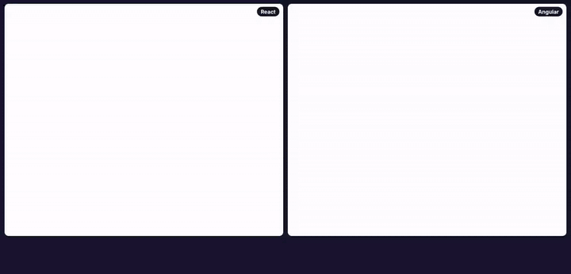
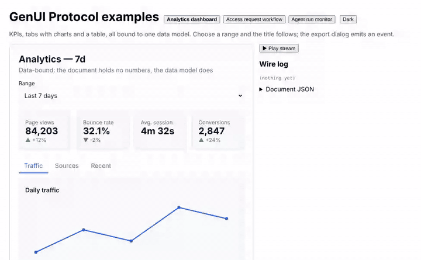
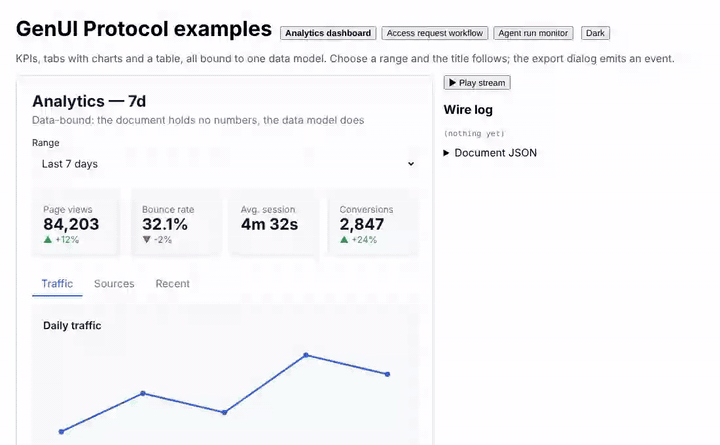

<p align="center">
  
</p>

# GenUI Protocol

**Let AI agents answer with interfaces, not just text — without letting them write frontend code.**

[](https://github.com/Pranavtej/GenUI-Protocol/actions)
[](LICENSE)
[](#status)

An agent emits a small declarative JSON **document**. A runtime validates it; a renderer draws it with your own components. There is no HTML, CSS or JavaScript from the model, so there is nothing to execute — and the same document can be rendered by any framework that implements the [protocol](spec/SPEC.md).


*Above: a form bound to a data model. Submit sends an event to an agent, which replies with patches; the workflow advances. Then a live run monitor updated by sequenced stream frames. Both are [examples](examples) you can run.*

```json
{
  "version": "1.0.0",
  "data": { "form": { "name": "" } },
  "root": {
    "t": "card", "p": { "title": "Sign up" },
    "c": [
      { "t": "input",  "p": { "label": "Name", "value": { "$bind": "form.name" } } },
      { "t": "text",   "p": { "content": { "$tpl": "Hello {{form.name}}" } } },
      { "t": "button", "p": { "label": "Send", "onClick": { "do": "submit", "name": "signup", "from": "form" } } }
    ]
  }
}
```

## See it work

Every clip is recorded from the real apps in this repo with [`scripts/demo`](scripts/demo); MP4 versions are in [`docs/assets/demos`](docs/assets/demos) and on the docs site's [Demos](apps/docs/pages/demos.mdx) page.

**Edit JSON, watch charts and graphs re-render** — the playground: change `bar` to `line` to `pie`, change a value, break the document and fix it, then switch to an agent run drawn as an execution graph and timeline.


**Charts, KPIs and tables from one data model, updated by a stream**


**One document, two renderers** — React (left) and Angular (right), updated by the same stream



**Cards and forms that talk to an agent** — bound inputs, a submit action, and an agent reply that advances a workflow



**A live agent run** — execution graph, counters and timeline updated by sequenced patches



## What you get

- **A protocol** — document model, data binding, declarative actions, RFC 6902 patches, sequenced streaming. [Spec](spec/SPEC.md), [JSON Schemas](spec/schemas), and language-neutral [conformance fixtures](conformance) that both the TypeScript and Python implementations pass.
- **A hardened runtime** — validator with size/depth limits, URL checks and allow-lists; id-keyed diff; atomic patches; an ordered stream consumer that resyncs when it falls behind.
- **Renderers** — React and Angular, all 23 built-in components, theming via CSS variables, custom components.
- **Agent tooling** — an MCP server, a prompt kit generated from the component registry, a validate-and-repair loop, JS and Python SDKs, a CLI, and `genui-eval` to measure how reliably a model produces valid documents.

## Try it

```bash
git clone https://github.com/Pranavtej/GenUI-Protocol.git && cd GenUI-Protocol
pnpm install && pnpm build

pnpm --filter genui-protocol-example-react dev      # examples: http://localhost:4175
pnpm --filter genui-protocol-docs dev               # the docs site
```

Render a document in React:

```tsx
import { GenUiRenderer, createSession } from "@genui-protocol/renderer-react";

const session = createSession({ document, onEmit: (event) => agent.send(event) });
<GenUiRenderer session={session} />;
```

Build one in code (TypeScript or Python), then validate it:

```ts
import { ui, bind, actions, document, assertValid } from "@genui-protocol/sdk-js";

assertValid(document(
  ui.card({ title: "Sign up" },
    ui.input({ label: "Name", value: bind("form.name") }),
    ui.button({ label: "Send", onClick: actions.submit("signup", "form") })),
  { form: { name: "" } },
));
```

```bash
genui validate doc.json      # exit 1 + readable errors when invalid
genui prompt                 # the LLM system prompt, generated from the registry
```

Full documentation lives in [`apps/docs`](apps/docs) (generated spec, component reference, tutorials, LLM guide).

## Status

Early (0.x). Implemented and tested: the protocol, runtime, React and Angular renderers, MCP server, SDKs, CLI, prompt kit and eval harness.

| | |
|---|---|
| **Not published yet** | Release automation (changesets, npm provenance, PyPI trusted publishing) is in place and tested end to end on packed tarballs, but no packages have been released. |
| **Never run against a real model** | `genui-eval` is built and tested with fake models; no first-try-validity numbers exist yet. |
| **Other renderers** | Vue, Svelte, React Native, SwiftUI and Flutter are *not* implemented. |
| **Missing protocol features** | Remote data sources, form validation rules, partial-document streaming, WebSocket transport. |

See the docs' [Status & features](apps/docs/pages/features.mdx) and [Roadmap](apps/docs/pages/roadmap.mdx).

## Repository map

```
spec/            protocol specification and published JSON Schemas
conformance/     language-neutral test vectors (patches, validation, bindings, actions, rendering)
packages/        core, runtime, components, renderers (react, angular), sdk (js, python), tooling (cli, eval, prompt-kit, theme-engine)
apps/            docs, mcp-server, playgrounds (react, angular), registry-ui, test-app + python agent
examples/        three runnable documents with a scripted agent, a React app, node and python scripts
```

## Contributing

Read [CONTRIBUTING.md](CONTRIBUTING.md) and the [Code of Conduct](CODE_OF_CONDUCT.md). Protocol changes update the spec, schemas, conformance fixtures and both implementations together. Security issues: see [SECURITY.md](SECURITY.md).

## License

MIT — see [LICENSE](LICENSE).
