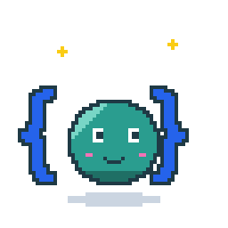
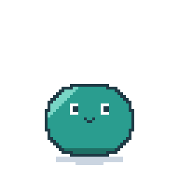
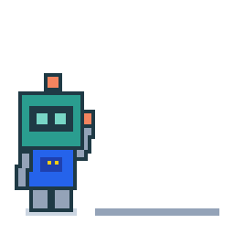
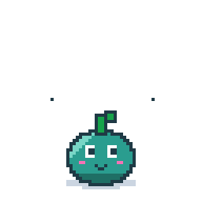

# Mascot options

Pick one (or ask for changes). Source: `scripts/mascot/opt_*.py`. Open [`preview.html`](preview.html) for light/dark and small-size previews.

| | |
|---|---|
| **A · Curly** — a smiley held in curly braces `{ ☻ }` that pops UI widgets out of its head |  |
| **B · Morph** — a jelly blob that becomes what the document says: card → button → checkbox |  |
| **C · Builder** — a robot that catches UI blocks and stacks them into a dashboard |  |
| **D · Sprout** — a tree-spirit that is an AST: it grows nodes and the leaves become widgets |  |
